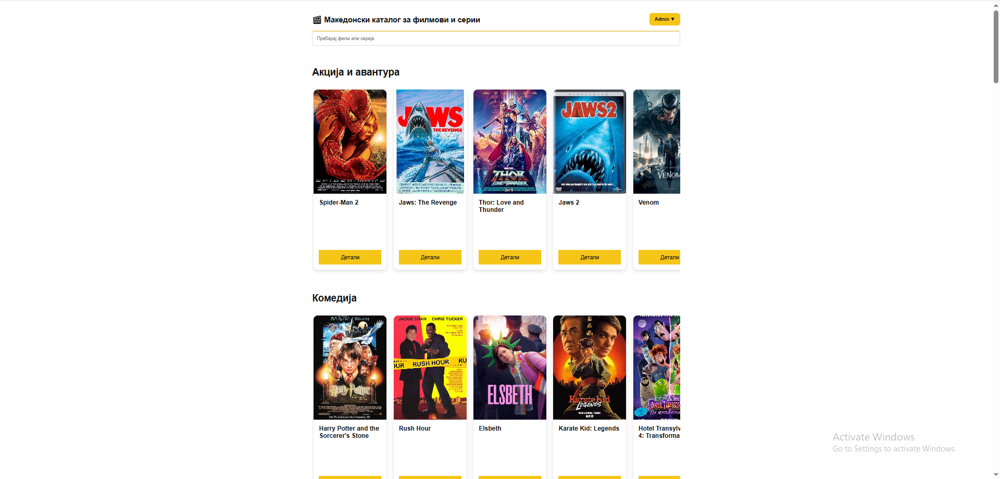
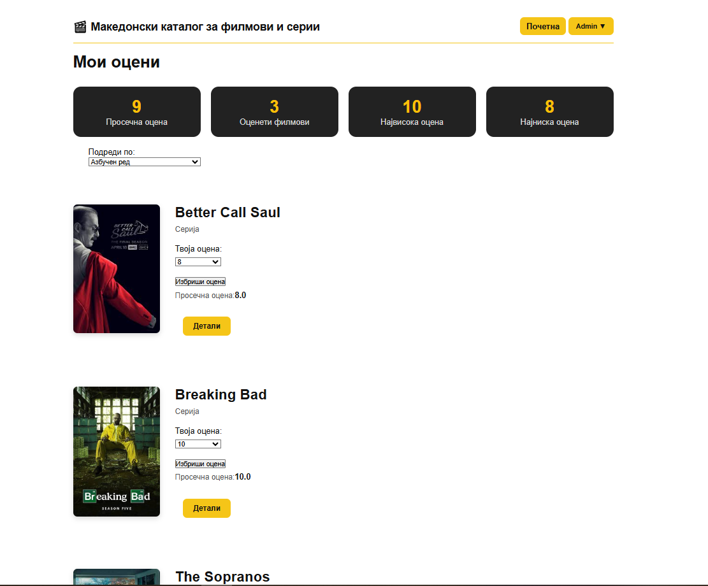
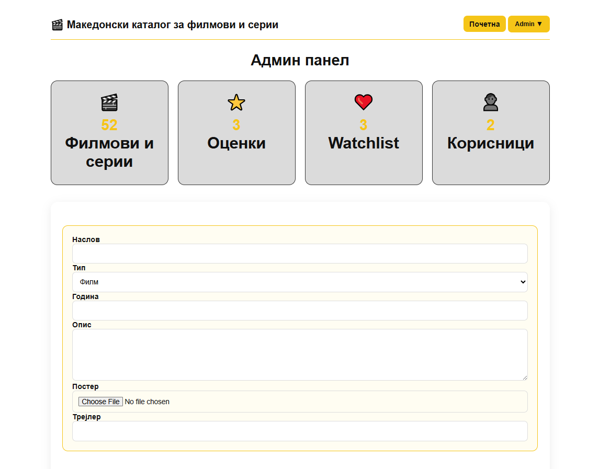

# 🎬 Movie Hub

Movie hub is a web application for managing and organizing movies and shows. The project is made as a personal project in order to practically improve the knowledge of web programming. 

---

## 📌 Main features

- Users registration and login
- Searching movies and TV Shows
- Detailed information about every movie
- Favorite movies
- Users profile
- Admin panel
- Adding, editing and deleting content

---

## 🛠 Used Technologies

- HTML5
- CSS3
- JavaScript
- PHP
- MySQL
- XAMPP

---

## 📷 Screenshots

### 🏠 Home Page



---

### 🎬 Movie Details


---

### ⭐ My Ratings



---

### ❤️ My Watchlist


---

### 🛠️ Admin Panel



---

## ⚙️ Installation

1. Copy the repository.
2. Paste the repository in the folder `xampp/htdocs`.
3. Start Apache and MySQL through XAMPP.
4. Import the database `moviehub.sql` in phpMyAdmin.
5. Open:

http://localhost/Moviehub

---

## 📂 Project Structure

```text
movie-hub
│
├── Database/
│   └── moviehub.sql
│
├── Screenshots/
│   ├── home-page.png
│   ├── movie-details.png
│   ├── my-ratings.png
│   ├── my-watchlist.png
│   ├── admin-panel.png
|   └── Statistika.png
│
├── Source/
│   ├── index.php
│   ├── movie.php
│   ├── dashboard.php
│   ├── login.html
│   ├── login_process.php
│   ├── signup.html
│   ├── register.php
│   ├── logout.php
│   ├── navbar.php
│   ├── session_check.php
│   ├── database.php
│   ├── add_movie.php
│   ├── edit_movie.php
│   ├── update_movie.php
│   ├── delete_movie.php
│   ├── admin.php
│   ├── admin_check.php
│   ├── ratings.php
│   ├── rate.php
│   ├── watchlist.php
│   ├── watchlist_page.php
│   ├── remove_watchlist.php
│   ├── script.js
│   ├── admin.js
│   ├── style.css
│   ├── admin.css
│   └── settings.css
│
└── README.md
```

## 👨‍💻 Author

Damjan Gjurik
